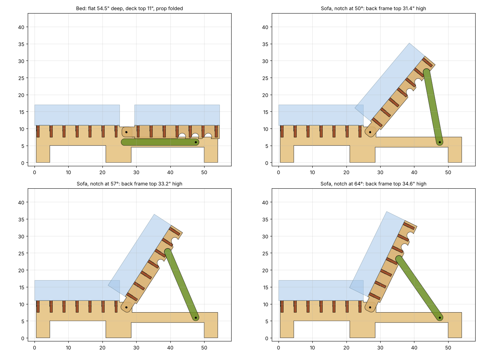

# OSB bifold futon (KD Studio Bifold, converted)

This is the KD Frames Studio Bifold redrawn for 23/32" OSB on a Maslow. It keeps the original's two frames: the **seat (bottom) frame** and the **adjustable back frame**. The two frames pivot on one bolt each side, and the back is held up by a fold-down prop that seats in notches under the back rails. That's the same idea as KD's notched ratchet.

## Solid wood → OSB, part by part

| KD solid wood | OSB version |
|---|---|
| Seat frame end rails + round legs | **seat-rail** x2: one profile with front leg, centre leg, pivot ear, rear arm and rear leg |
| Back frame end rails | **back-rail** x2: rail with pivot ear and 3 recline notches cut on the underside |
| Flat slats at 4" spacing | **seat-slat** / **back-slat** x7 each: slats on edge (3.5" tall), cross-lapped into the rails like an egg crate |
| Seat-to-back link block + bolts | 3/8" bolt through the overlapping pivot ears (the back rails sit just inside the seat rails) |
| Toothed ratchet rail + back strut | **prop** x2: bolted to the seat rail's rear arm. Its rounded tip drops into one of 3 notches under the back rail |
| Centre support block | Included automatically for full or queen width (`back-center-rail` and a third seat rail) |

## Size used

The default is **chair size**: 32" across, with the deck top at 11" so it sits at 17" with a 6" cushion. Front-to-back it keeps the KD numbers: 25" seat + 4.5" gap + 25" back = 54.5" flat. To build the sizes from the sheet instead:

- Full: `python3 generate.py --width 74 --deck-top 10` (2 sheets)
- Queen: `python3 generate.py --width 78 --deck-top 10`

## Recline settings

The notches are at 50°, 57° and 64° from flat. The top of the back frame ends up at 31.4", 33.2" and 34.6" high. To change them, run `--angles 45,55,65`; the script re-solves the prop length and notch positions. It also checks that no parts collide when flat, at each setting, and through the whole swing.

## Material and hardware

- 1 sheet of 23/32" OSB at chair size.
- 4 x 3/8" x 2-1/2" carriage bolts, each with 2 fender washers and a nylon lock nut. Two are for the seat/back pivots, two for the props.
- 1/4" end mill. Every inside corner has a dogbone. Slot width = thickness + 0.04".

## Files

- `cut/sheet-1.dxf` (+ .svg): the nested sheet, in inches. Cut `CUT_INSIDE` first, then `CUT_OUTSIDE`. `SHEET_REF_DO_NOT_CUT` is only the 48x96 outline.
- `parts/*.dxf|svg`: one file per part.
- `parts-list.csv`, `nesting.png`, `side-views.png`
- `generate.py`: rebuilds everything. Measure your OSB first: `python3 generate.py --thickness 0.705`

## Assembly

1. Seat frame: stand the two seat rails up and drop the 7 seat slats in, slots down.
2. Back frame: same with the back rails and back slats. The back slats are 1.2" shorter and their ends stick out past the back rails.
3. Set the back frame between the seat rails so the pivot ears overlap, then bolt them through. Laid flat, the back slat ends rest on the seat rails' rear arms.
4. Bolt a prop to the inside of each rear arm. To sit up: lift the back, swing the props up, and seat both tips in matching notches. For bed: lift the back slightly, fold the props forward, and lower the back flat.

## Notes

- Do a test cut of one slot to check the fit before cutting the sheet. Seal the edges so the slots don't swell shut.
- Slats on edge are much stiffer than flat OSB slats. That's why they replace the wood slats instead of copying them flat.
- Leave the pivot nuts snug but not tight, so the back can still swing.
