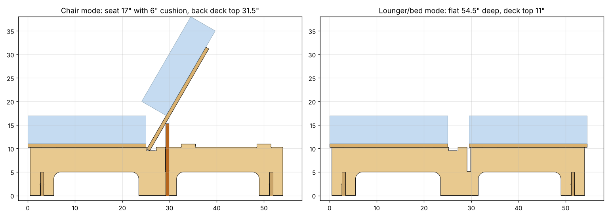

# Flat-pack OSB bifold futon chair

A chair-width version of the KD Frames Studio Bifold, redesigned as slot-and-tab 23/32" OSB parts for a Maslow (4x8) router. Nothing in it needs screws, bolts or glue.

## Key numbers (defaults)

| | |
|---|---|
| Chair width | 32" deck, for a chair-size mattress about 32" wide |
| Seat height | deck top 11", so 17" with a 6" cushion |
| Bed/lounger depth | 54.5" flat (25" seat + 4.5" gap + 25" back, same as the KD sheet) |
| Back | leans at 60°, top edge about 31.5" |
| Material | 2 sheets of 23/32" OSB (sheet 2 is mostly offcut) |
| Bit | 1/4" end mill, dogbones on every inside corner |
| Slot width | measured thickness + 0.04" (0.759" by default) |

## Parts ([parts-list.csv](parts-list.csv))

| Part | Qty | Size | What it does |
|---|---|---|---|
| rib | 3 | 53.5 x 10.9 | Legs and deck supports. Tabs on top locate the decks. |
| deck | 2 | 25 x 32 | Seat and back are identical; vent slots at 4" pitch |
| stretcher | 2 | 31 x 5 | Front and rear, cross-lapped into the rib feet |
| back-support | 1 | 31 x 15.3 | Holds the back up in chair mode; lifts out for bed mode |

## How the fold works

The original uses a pivoting ratchet. Here it's a removable support panel instead, because that cuts flat and needs no hardware:

- **Chair mode:** drop the back-support panel into the slots in the ribs just behind the seat. Set the back deck's bottom edge into the small heel notch at the back of the seat, then lean the deck against the panel's top edge.
- **Bed mode:** lift the back deck off and pull out the panel. Lay the deck flat on the rear rib tabs. The panel slides flat under the frame through the rear arches, so it stays stored with the chair.

Trade-off: the ribs stay full length, so in chair mode the footprint is still 54.5" deep. The original's linkage folds down to 46".

## Files

- `cut/sheet-1.dxf`, `cut/sheet-2.dxf`: nested sheets, in inches. Cut `CUT_INSIDE` first, then `CUT_OUTSIDE`. `SHEET_REF_DO_NOT_CUT` is only the 48x96 outline. SVG copies sit alongside them.
- `parts/*.dxf|svg`: one file per part, in case you'd rather nest it yourself.
- `nesting.png`: sheet layout preview. The strong axis of the OSB runs along the 8' length and along each deck's 32" span.
- `generate.py`: regenerates everything. Measure your OSB in a few spots first, then run:
  `python3 generate.py --thickness 0.705` (other options: `--clearance`, `--bit`, `--width`, `--deck-top`).

## Cutting and assembly notes

1. Do a test cut first: one slot plus a 3" strip, to check the fit. OSB swells at cut edges and the Maslow drifts toward the sheet edges. If a joint is tight, raise `--clearance` to 0.06.
2. Use your CAM's holding tabs (or onion-skin) on the outside cuts, especially the long ribs.
3. Assembly: stand both stretchers on the floor with slots up and drop the three ribs down over them (rib slots go down). Then set the seat deck on the front tabs. A mallet is fine; nothing should need forcing.
4. Seal the edges (shellac or paint) before assembly so humidity doesn't swell the slots shut.
5. Strength: ribs sit 14" apart, well under OSB's 24" floor-span rating, and the rib beam over each arch is 5.3" deep.

Sheet 2 has about a 48 x 63 offcut left over, which is room for arms or a side table.
